# InterviewBud: technical architecture

InterviewBud runs a live, spoken technical screening interview against a candidate's resume. It speaks with a
self-hosted voice, sees a shared code editor, whiteboard and notes, and runs the candidate's code in a sandbox. It
scores the interview against an anchored rubric, then critiques its own interviewing and proposes lessons for the
next one.

This document describes how the whole system works end to end, as built, with the numbers measured on the
reference machine (Apple M5, 24 GB) on 2026-10-18.

Contents

1. [System overview](#1-system-overview)
2. [Processes, ports and deployment](#2-processes-ports-and-deployment)
3. [Interview lifecycle, end to end](#3-interview-lifecycle-end-to-end)
4. [Preparation: resume to profile to plan](#4-preparation-resume-to-profile-to-plan)
5. [The live voice loop](#5-the-live-voice-loop)
6. [Turn-taking](#6-turn-taking)
7. [The session runtime and its tools](#7-the-session-runtime-and-its-tools)
8. [Speech: STT and the TTS providers](#8-speech-stt-and-the-tts-providers)
9. [The workspace: code, whiteboard, notes](#9-the-workspace-code-whiteboard-notes)
10. [Coding: problem bank, tests and the sandbox](#10-coding-problem-bank-tests-and-the-sandbox)
11. [Working memory](#11-working-memory)
12. [Evaluation](#12-evaluation)
13. [Self-improvement](#13-self-improvement)
14. [CopilotKit and AG-UI](#14-copilotkit-and-ag-ui)
15. [Data model](#15-data-model)
16. [Wire protocols](#16-wire-protocols)
17. [Configuration](#17-configuration)
18. [Measured latency and where it goes](#18-measured-latency-and-where-it-goes)
19. [Guardrails, privacy and consent](#19-guardrails-privacy-and-consent)
20. [Accounts, sessions and security model](#20-accounts-sessions-and-security-model)
21. [Preparation journey: from a job link to practice](#21-preparation-journey-from-a-job-link-to-practice)
22. [Known limits](#22-known-limits)

---

## 1. System overview

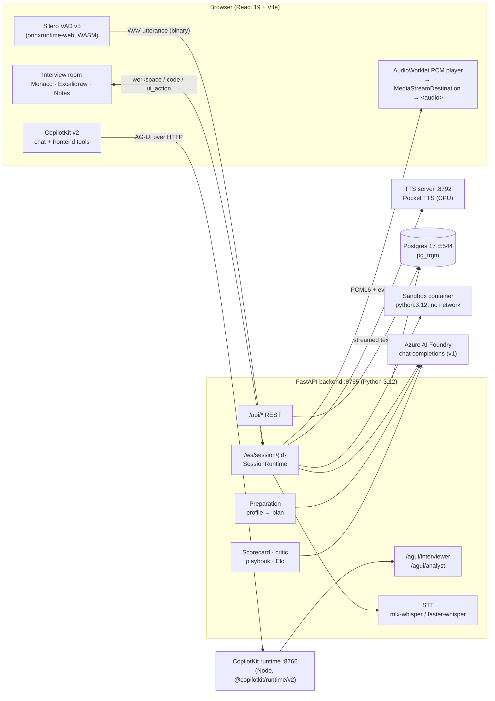

The design rules that shape everything below:

* **One runtime per interview.** `SessionRuntime` (`backend/app/session.py`) owns all live state: history,
  working memory, the current reply, the TTS stream, the workspace and the problem. Every transport (the
  WebSocket voice client, CopilotKit chat over AG-UI, and system events) goes through it.
* **Latency-critical path stays thin.** Only STT, the end-of-turn gate, the LLM stream, the sentence chunker and
  TTS sit between "candidate stops talking" and "interviewer starts talking". Memory extraction, persistence and
  scoring all run off that path.
* **Nothing invented.** Problems, reference solutions and tests come from a real dataset. Expected outputs for
  interviewer-added tests are computed by running the reference solution. Scores must cite transcript evidence.

---

## 2. Processes, ports and deployment

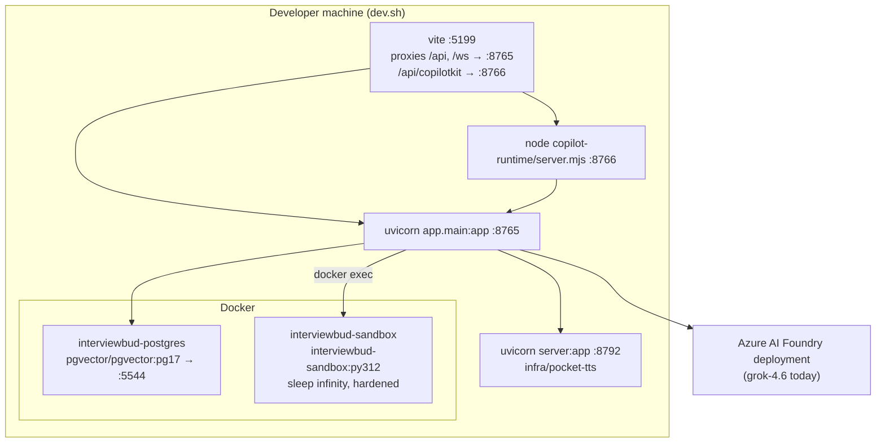

| Process | Port | Started by | Notes |
|---|---|---|---|
| Web (Vite) | 5199 | `dev.sh` | Serves the SPA. `vite-plugin-static-copy` publishes the VAD model, worklet and onnxruntime WASM at `/vad/`, flattened with `rename: { stripBase: true }` (plugin v4 keeps folders by default). |
| API (FastAPI) | 8765 | `dev.sh` | REST, WebSocket sessions, AG-UI agents, preparation, scoring. On startup: create schema, ingest the problem bank, start the sandbox, warm STT and TTS in the background. |
| CopilotKit runtime | 8766 | `dev.sh` | Thin Node proxy: `CopilotRuntime` with two `HttpAgent`s pointing at `/agui/interviewer` and `/agui/analyst`. |
| TTS (Pocket TTS) | 8792 | `dev.sh` when `TTS_PROVIDER=pocket` | CPU-only, bearer-key protected, bound to 127.0.0.1. |
| Postgres | 5544 | `infra/docker-compose.yml` | `pg_trgm` for lesson de-duplication. |
| Sandbox | none | API on startup | Warm container, one `docker exec` per code run. |

Alternative TTS deployments live next to Pocket TTS: `infra/fish-speech/compose.yml` (Fish S2-Pro on an NVIDIA GPU)
and `infra/chatterbox/` (Chatterbox-Turbo, CUDA, with in-sentence streaming). See section 8.

---

## 3. Interview lifecycle, end to end

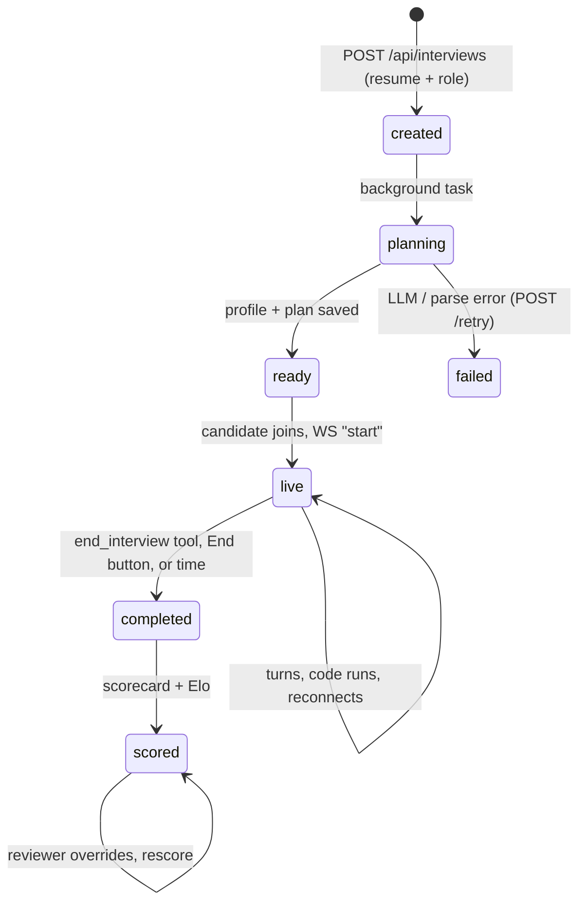

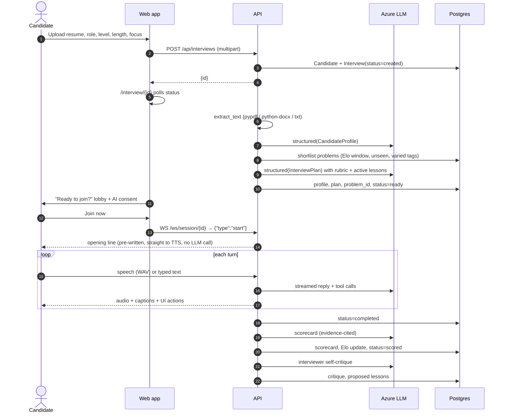

---

## 4. Preparation: resume to profile to plan

`backend/app/api/interviews.py::prepare` runs as a background task after the upload.

1. **Text extraction** (`agent/resume.py`): pypdf for PDF, python-docx for DOCX, UTF-8 for text.
2. **Profile** (`structured(CandidateProfile)`): roles with highlights and technologies, projects, education,
   *claims* (checkable statements with numbers), and conversation hooks. The prompt excludes protected
   characteristics; dates are kept only as tenure.
3. **Shortlist** (`agent/planner.py::shortlist`):
   * class-method problems only (`Solution().…`), with a description under 2,600 characters;
   * Elo within ±220 of a seniority target;
   * excludes problems this candidate has already seen;
   * prefers the dataset's test split and recent problems, and varies tags;
   * returns up to 24 candidates.
4. **Plan** (`structured(InterviewPlan)`):
   * the spoken lines: `opening_line` (≤25 words), `persona_intro` facts (≤40 words) and `coding_framing`
     (≤25 words);
   * `background_questions`, written as a person would say them;
   * per project, a probe ladder: opening question, probes, the claims to check and the signals sought;
   * 2–3 `technical_topics` tied to resume items, each with a description of a strong answer;
   * `coding_problem_id` and `coding_focus`;
   * `phase_budgets` for 30, 45 or 60 minutes.

   The prompt includes the anchored rubric and the active playbook lessons for planning, and spells out in
   examples the difference between AI-ish and human questions.

Measured with grok-4.6 (a reasoning model): preparation took **2 min 38 s** (profile plus plan).

Example output for the test persona:

> **Opening:** "Hey Maya, thanks for jumping on. I saw the Kafka Streams settlement work, really curious about that.
> How's your day going?"
> **Project opener:** "Okay so, the Kafka Streams migration. What was your piece of that?"
> **Technical:** "How does a Kafka Streams state store survive a restart?"

---

## 5. The live voice loop

### 5.1 One turn, end to end

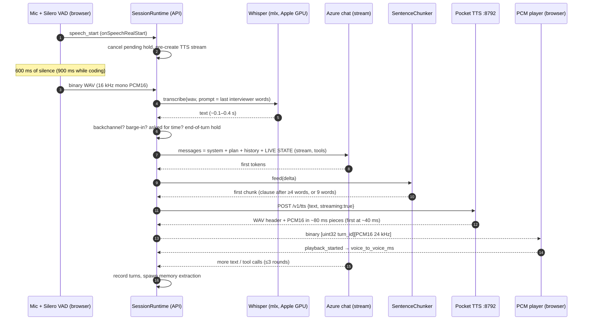

### 5.2 Browser audio path

* **Capture:** `@ricky0123/vad-web` 0.0.31 with Silero v5.
  * Thresholds: positive 0.55, negative 0.40. `minSpeechMs` 250, `preSpeechPadMs` 300.
  * `redemptionMs` 600, raised to 900 in the coding phase so think-aloud pauses don't end the turn.
  * The utterance is encoded as 16 kHz mono PCM16 WAV and sent as one binary frame.
* **Playback:** `public/pcm-player.worklet.js` is a ring buffer that resamples the 24 kHz PCM to the
  AudioContext's rate.
  * It is routed through `MediaStreamDestination` into an `<audio>` element. That puts the interviewer's voice
    on the browser's echo-cancellation reference, so the mic doesn't hear it.
  * The worklet reports `started`, `drained` and an RMS `level`, which drives the speaking ring on the tiles.
* **Barge-in** (`lib/useInterview.ts`):
  * When the candidate starts talking over the interviewer, playback is ducked at once.
  * If speech continues past 700 ms, the client sends `barge_in`, clears the player and drops any audio still
    in flight for that turn (the turn id in each audio frame makes stale audio identifiable).

### 5.3 The room

The room is laid out like a video call:

* **Lobby:** a "Ready to join?" screen with a camera preview (local only, never sent) and the AI-interview
  consent.
* **Stage:** the shared workspace takes most of the screen, with Code, Whiteboard and Notes tabs.
* **Right column:** the interviewer tile, whose ring moves with the TTS level, then the candidate tile (camera or
  initial, ring driven by the VAD probability), then the transcript or CopilotKit chat.
* **Control bar:** mic, camera, transcript, chat, and a red hang-up button.

---

## 6. Turn-taking

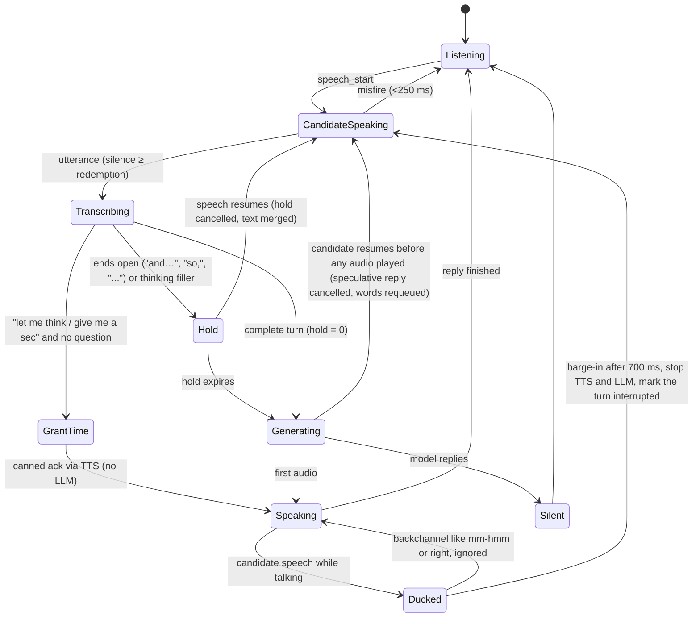

The end-of-turn gate (`voice/turns.py`) is cheap and synchronous, because it sits on the critical path.

| Rule | Hold |
|---|---|
| Ends with terminal punctuation (Whisper punctuates) | 0 ms |
| Ends open: comma, dash, "...", or a trailing continuer ("and", "so", "because", "the"...) | 1,400 ms |
| Filler only ("um", "okay") in the coding phase | 1,500 ms |
| Coding phase | +400 ms |
| Long, complete answer (>15 s of speech) | −200 ms |
| Explicit request for time, no question mark | no hold: spoken acknowledgement ("Sure, take your time."), then silence |

Other mechanisms:

* **`<listen/>`:** the model can choose to stay silent, for example during think-aloud while coding. If the
  marker appears inside spoken text, it is stripped before TTS.
* **Silence watcher:** in the coding phase, 150 s with no speech and no code change sends the model a system
  event; it decides whether to check in.
* **Reconnect:** a reconnecting browser triggers a system event, and the model welcomes them back and picks up
  where it left off. All state is server-side.

---

## 7. The session runtime and its tools

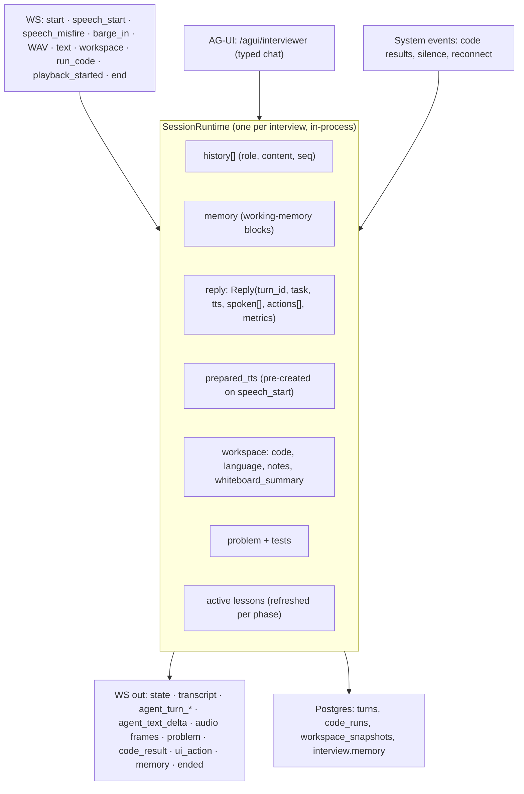

**Prompt assembly** (`_messages`). The prompt is laid out to be cache-friendly:

* **Static first:** the persona with its spoken-style rules, turn-taking, method, hint ladder, guardrails,
  workspace awareness and rubric. Then the plan and profile; the opening line is left out because it's already
  in the history.
* **The conversation:** the history.
* **Last, a trailing system message, `LIVE STATE`** (`_live_state`): the phase and its time budget, elapsed
  minutes, the workspace (code, last test summary, whiteboard description, notes), the working-memory render, and
  the lessons active for this phase.

**Generation** (`_generate`):

* The chat deployment streams with `tools=TOOLS`. If the first characters are `<listen/>`, the turn stays
  silent; otherwise text flows into the chunker, then into TTS.
* Tool calls run, and their results go back for up to 3 rounds. If text was already spoken and every tool call
  was fire-and-forget, no extra round happens.
* `reasoning_effort` is sent when `AZURE_OPENAI_CHAT_REASONING_EFFORT` is set, which is needed for models that
  always reason.

| Tool | What it does | Round trip? |
|---|---|---|
| `advance_phase(to, reason)` | Moves the phase, logs its duration, refreshes phase-scoped lessons | fire-and-forget |
| `present_problem()` | Loads the planned problem and its tests and shows the code panel | returns the problem |
| `give_hint(level 0–5, hint)` | Records the hint level, which later caps problem solving | fire-and-forget |
| `run_tests()` | Runs the candidate's current code against all tests | returns the summary |
| `add_test_case(args, rationale)` | Adds a visible test; the expected output comes from the reference solution | returns the test |
| `show_panel(panel)` | Brings code, whiteboard or notes forward in the browser | fire-and-forget |
| `draw_on_whiteboard(title, nodes, edges)` | Sketches boxes and arrows (Excalidraw skeleton) | fire-and-forget |
| `end_interview(reason)` | Ends after the closing line has been spoken | fire-and-forget |

---

## 8. Speech: STT and the TTS providers

### 8.1 Speech-to-text

| `STT_PROVIDER` | Engine | Measured |
|---|---|---|
| `local` (default on this machine) | **mlx-whisper** `small.en` on the Apple GPU; **faster-whisper** int8 on CPU elsewhere | 9.3 s answer → **0.62–0.75 s**; live turns 0.1–0.4 s. CPU faster-whisper was 2.7–3.5 s. |
| `fish` | Fish Audio cloud `POST /v1/asr` (`transcribe-1-pro`) | not measured (no key) |
| `azure` | Azure OpenAI `audio.transcriptions` | not measured |

* The browser's WAV is decoded directly, without PyAV, because the installed PyAV dropped an argument
  faster-whisper passes.
* The last 200 characters of the interviewer's turn are passed as the initial prompt, which biases vocabulary
  ("Kafka Streams", "idempotency").
* Greedy decoding, no internal VAD: the browser already cut the utterance.

### 8.2 Text-to-speech: one client, four backends

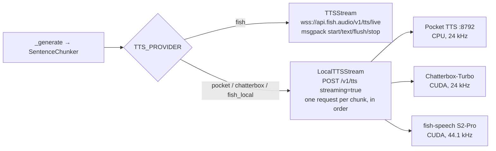

All three self-hosted servers speak the same subset of fish-speech's HTTP API, so the app has one client:

* `POST /v1/tts` takes msgpack or JSON: `{text, reference_id, format, streaming, ...}`. With `streaming=true`
  it returns a 44-byte WAV header whose sizes are `0xFFFFFFFF`, then PCM16 mono as it is generated.
* `POST /v1/references/add`, `GET /v1/references/list` and `DELETE /v1/references/delete` manage voices. The
  Settings page clones voices through them.
* `GET /v1/health`.

`LocalTTSStream` (`voice/tts.py`):

* Queues chunk texts and streams each response in order, so sentence n+1 is generated while sentence n plays.
* Strips the WAV header, keeps 16-bit sample alignment across reads, and checks the header's sample rate against
  `TTS_SERVER_SAMPLE_RATE`.
* `close()` cancels the in-flight request. The Pocket TTS server sees the disconnect and stops generating
  (`stop` event), which is what makes barge-in instant.

Before text reaches TTS:

* Voice cues are stripped from captions. A cue counts only when it stands alone (`[chuckle] Fair enough`);
  brackets attached to a name are code and are kept (`nums[i]`).
* `speakable()` reads code indexing aloud the way people do (`nums[i-1]` → "nums at i minus 1").
* The persona's voice-cue guidance depends on the provider: Pocket TTS gets none, Chatterbox gets only its 19
  supported tags, and Fish gets free-form cues.

### 8.3 Why Pocket TTS: what was measured

| Option | Where it ran | First audio | Speed | Verdict |
|---|---|---|---|---|
| Fish S2-Pro (4.6B, open weights) | This Mac's GPU (MPS) | — | ~60 s per audio frame (needs 21.5 frames/s) | Unusable here: no MPS support, memory pressure. Needs an A100/H100-class GPU; the weights are research-licence only. |
| Chatterbox-Turbo (350M, MIT) | Azure NV12ads_A10_v5 (a third of an A10) | 1.1 s (3 words), 2.5–3 s (sentence) | RTF 0.73–0.86 per sentence; 12.7 ms/token in bf16 | Workable only with in-sentence streaming (written in `infra/chatterbox/server.py`). The VM is deallocated. |
| Chatterbox-Turbo / Nano | This Mac (CPU, MPS) | 2–10 s per sentence | RTF 1.2–5 | Too slow. |
| **Pocket TTS (Kyutai, ~100M)** | **This Mac's CPU** | **35–56 ms** | **8–11× real time** | **In use.** Word-perfect on a Whisper round trip; stops instantly on barge-in. Voice cloning needs Kyutai's gated weights (accept the terms on Hugging Face); the 27 catalog voices work without them. |

---

## 9. The workspace: code, whiteboard, notes

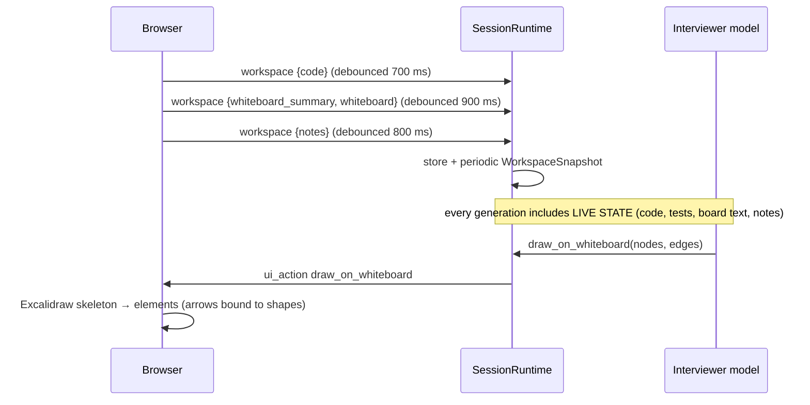

The interviewer "sees" the whiteboard as text. `Whiteboard.tsx::describe()` turns the Excalidraw scene into
lines like these, so the model can talk about what the candidate drew without vision:

```
Shapes: rectangle "API gateway", rectangle "SQS queue", ...
Arrow: API gateway -> SQS queue
Text: "retry 3x"
4 freehand strokes
```

When the interviewer draws:
* nodes go on a grid;
* arrows are routed centre to centre, clipped to each shape's edge, and keep `start`/`end` bindings so they
  follow the shapes if they're dragged;
* after the panel is shown, the board waits two animation frames, then refreshes and scrolls to the drawing
  (otherwise a hidden canvas measures zero size).

---

## 10. Coding: problem bank, tests and the sandbox

### 10.1 Problem bank

The source is **LeetCodeDataset** (`newfacade/LeetCodeDataset` on Hugging Face, Apache-2.0): 2,641 train and 228
test problems, each with its description, starter code, preamble (imports and helpers), entry point, reference
solution and asserts. `coding/dataset.py` downloads it once and loads it into Postgres:

* Each `assert` is parsed with `ast` (`coding/asserts.py`) into `call_args`, `expected_expr` and a comparison
  mode: `eq`, `same_list` or `same_tree`.
* **Test kinds:**
  * `sample`: asserts matching the description's examples, falling back to the two smallest;
  * `hard`: the 5 largest inputs;
  * `hidden`: the rest;
  * `injected`: added by the interviewer during an interview.
* Totals: 7,066 sample, 258,695 hidden and 14,245 hard tests.
* Initial Elo by difficulty: Easy 1200, Medium 1500, Hard 1800.

### 10.2 Running code

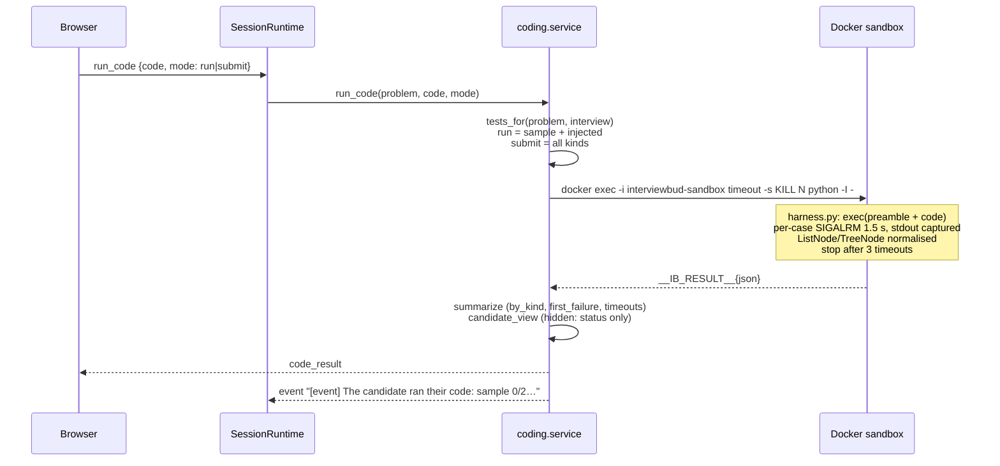

The sandbox is hardened:
* `--network none --read-only --tmpfs /tmp --memory 256m --cpus 1 --pids-limit 64 --cap-drop ALL`
  `--security-opt no-new-privileges --user 65534`;
* the image is `python:3.12-slim` plus `sortedcontainers`, which the dataset preambles import;
* the container is kept warm, and each run is a fresh `python -I` process, about 200 ms per submission.

**Injected tests.** `add_test_case` takes inputs only. The expected value is computed by running the
**reference solution** in the sandbox (`mode="eval"`), so the interviewer can never assert a wrong answer.
Verified: `l1=[9,9,9], l2=[1]` → `[0,0,0,1]`.

---

## 11. Working memory

Working memory is a set of MemGPT-style core blocks in `Interview.memory` (`agent/memory.py`):

| Block | Content |
|---|---|
| `facts` | Durable facts the candidate stated |
| `threads` | Open threads worth returning to |
| `claims` | Resume claims, each with a status (`consistent` / `inconsistent` / `unverified`) and evidence |
| `evidence` | Quote, dimension, polarity, turn: the raw material for the scorecard |
| `hints` | Level and minute of each hint |
| `rapport`, `sentiment` | How the candidate seems to be doing |
| `phase`, `phase_started`, `phase_history` | Time accounting per phase |
| `lessons_used` | Which playbook lessons were in play |

After each candidate turn, `_extract` asks the model for a `MemoryDelta`, which `apply_delta` merges. It runs in
the background under a lock. It waits until no reply is being generated, so on a rate-limited deployment the live
voice gets the token budget first. `render()` puts the memory into LIVE STATE.

---

## 12. Evaluation

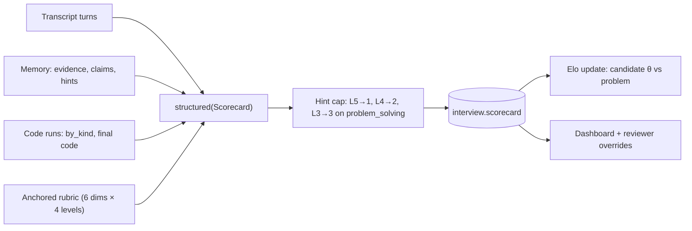

* **Dimensions:** communication, technical depth, ownership and impact, problem solving, coding, verification.
  Each has four behavioural anchors, adapted from the Tech Interview Handbook and Meta's engineering attributes.
* **Evidence:** every score must cite turns. A score of 0 means insufficient signal; the model must not guess.
* **Output:** a recommendation (`strong_hire` to `strong_no_hire`), strengths, concerns, verified and
  inconsistent claims, and the suggested focus for the next round.
* **Reviewer overrides:** a person can change any score. Each change is logged as `Feedback(kind=reviewer)`,
  which feeds self-improvement.

From the live test today: a strong no-hire, with every dimension at 1 and quoted evidence for each. It caught the
contradiction between "led the migration" on the resume and "I do not build anything here" in the interview.

---

## 13. Self-improvement

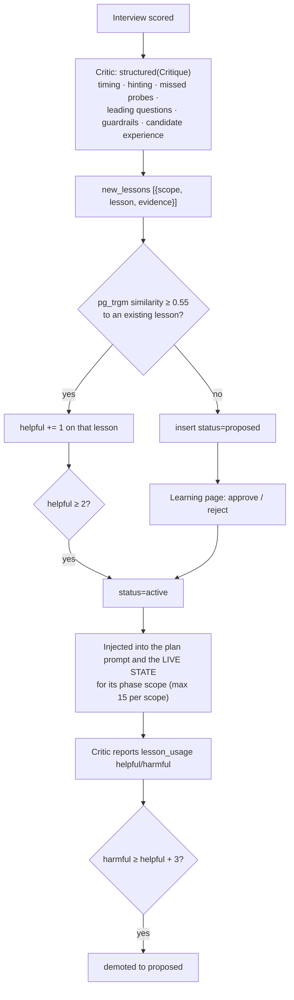

This is ACE-style playbook curation (Agentic Context Engineering): small itemised lessons rather than prompt
rewrites, with helpful and harmful counters. A lesson goes live only after a reviewer approves it or two
interviews independently find it. That stops a single bad critique from changing the interviewer.

Problem difficulty is calibrated as well. Each attempt updates the problem's Elo against the candidate's θ, using
an outcome built from:
* the hidden and sample pass rate;
* the hard pass rate;
* the highest hint level used;
* whether the solution was optimal.

From today's live run, the critic proposed four lessons:
* push once on personal contribution before letting a candidate skip a claimed project;
* don't mention the prefix trick before a working naive solution;
* if asked to write code, give the next small step instead of dictating;
* treat an immediate request for help as not yet stuck.

The critique finished about 3.5 minutes after the scorecard with grok-4.6.

---

## 14. CopilotKit and AG-UI

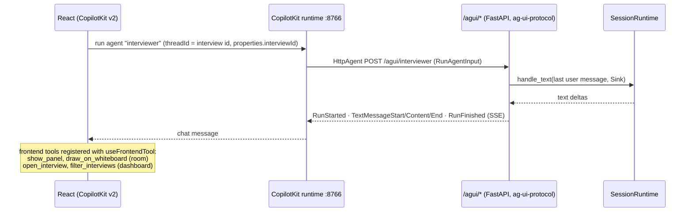

* `@copilotkit/react-core/v2` 1.79.1 provides `CopilotKit`, `CopilotChat`, `CopilotSidebar`, `useFrontendTool` and
  `useAgentContext`. `@ag-ui/client` is pinned at 1.0.2.
* The **interviewer** agent is typed chat into the same live session, so text and voice share one history.
* The **analyst** agent is the dashboard copilot:
  * server tools `list_interviews` and `get_interview` read the database;
  * frontend tools are emitted as AG-UI `ToolCall` events and executed in the browser, to open an interview or
    filter the table.

---

## 15. Data model

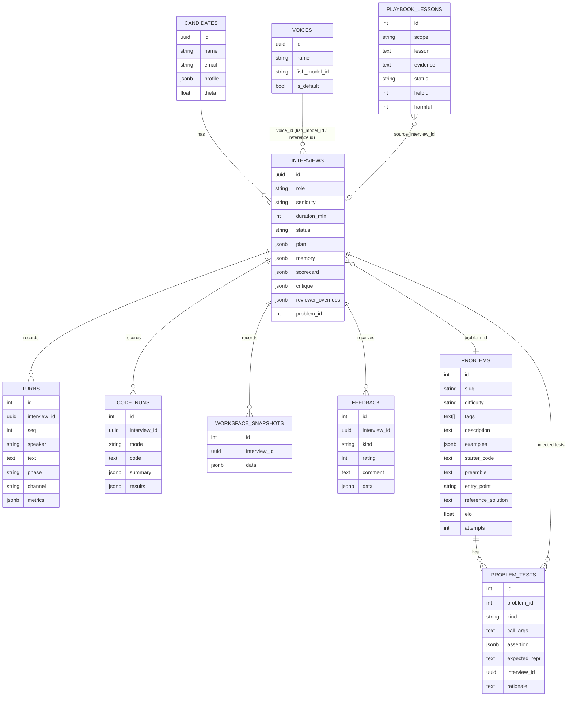

`turns.metrics` holds the per-turn latency breakdown: `stt_ms`, `hold_ms`, `llm_ttft_ms`, `tts_first_text_ms`,
`first_audio_ms`, `voice_to_voice_ms`, `barged_in`, `cancelled_speculative`, `listen` and `granted_time`.

---

## 16. Wire protocols

### Browser ↔ API (WebSocket `/ws/session/{id}`)

| Direction | Message |
|---|---|
| → | `start`, `speech_start`, `speech_misfire`, `barge_in`, `text {text}`, `workspace {...}`, `run_code {code, mode}`, `playback_started {turn_id, ms}`, `end`, `ping` |
| → binary | WAV utterance (16 kHz mono PCM16) |
| ← | `state`, `history`, `thinking`, `agent_turn_start`, `audio_start`, `agent_text_delta`, `agent_turn_end {text, listen, metrics}`, `interrupt`, `resume`, `listening_hold {ms}`, `transcript {speaker, text, partial}`, `problem`, `code_running`, `code_result`, `memory`, `ui_action {name, args}`, `ended`, `error`, `pong` |
| ← binary | `[uint32 LE turn_id][PCM16 mono @ sample_rate]` |

### API ↔ TTS server

`POST /v1/tts` takes msgpack:

```
{text, reference_id?, format: "wav", streaming: true, chunk_length: 100, normalize: true,
 use_memory_cache: "on", temperature: 0.7, top_p: 0.7}
```

It returns a 44-byte RIFF header with `0xFFFFFFFF` sizes, then PCM16. Closing the response stops generation.
Requests carry `Authorization: Bearer <TTS_SERVER_API_KEY>`.

### API ↔ Azure

The API uses the OpenAI v1 surface (`AsyncOpenAI(base_url=<resource>/openai/v1/)`):
* the live voice uses `chat.completions.create(stream=True, tools=…)`;
* preparation, scoring, critique and memory use `chat.completions.parse(response_format=PydanticModel)`.

---

## 17. Configuration

All settings come from `.env`, read by `backend/app/config.py`.

| Key | Purpose | Current |
|---|---|---|
| `AZURE_OPENAI_ENDPOINT`, `AZURE_OPENAI_API_KEY` | Azure resource (v1 endpoint) | your Foundry resource |
| `AZURE_OPENAI_CHAT_DEPLOYMENT` | Live interviewer voice | `grok-4.6` |
| `AZURE_OPENAI_CHAT_REASONING_EFFORT` | For models that always reason | `minimal` |
| `AZURE_OPENAI_REASONING_DEPLOYMENT` | Preparation, scoring, critique (defaults to the chat deployment) | (chat) |
| `TTS_PROVIDER` | `fish`, `fish_local`, `chatterbox` or `pocket` | `pocket` |
| `TTS_SERVER_URL`, `TTS_SERVER_API_KEY`, `TTS_SERVER_SAMPLE_RATE` | Self-hosted TTS | `http://127.0.0.1:8792`, (secret), `24000` |
| `FISH_API_KEY`, `FISH_TTS_MODEL`, `FISH_VOICE_ID` | Fish cloud | unset |
| `STT_PROVIDER`, `LOCAL_STT_MODEL` | `local`, `fish` or `azure`; Whisper model | `local`, `small.en` |
| `SANDBOX_PYTHON_IMAGE`, `SANDBOX_TIMEOUT_S`, `SANDBOX_MEMORY` | Code sandbox | `interviewbud-sandbox:py312`, 10, 256m |
| `DATABASE_URL` | Postgres | `…@localhost:5544/interviewbud` |

---

## 18. Measured latency and where it goes

These come from the live run on 2026-10-18 (real mic and speakers, Mac GPU Whisper, Pocket TTS, Azure grok-4.6 at
`reasoning_effort=minimal`):

| Stage | Typical | Notes |
|---|---|---|
| VAD end-of-speech | 600 ms (900 coding) | The silence the VAD needs before it closes the utterance. |
| STT | 100–400 ms | mlx-whisper `small.en` on the Apple GPU. |
| End-of-turn hold | 0 ms on complete answers | 1.4 s when the answer trails off; requests for time are acknowledged with no LLM call. |
| LLM time to first token | **2.0–3.9 s, worse under load** | grok-4.6 always reasons and can't be turned off. Rose to 6–8 s when the deployment's 50k tokens/min limit returned HTTP 429 and the client backed off. |
| Chunker to TTS first audio | 40–60 ms | Pocket TTS. |
| **Speech end to interviewer's first audio** | **2.3–4.5 s** | Almost all of it is the LLM. |

Next step for a natural feel (about 1 s): deploy a fast non-reasoning chat model (gpt-4.1-mini or similar) for
`AZURE_OPENAI_CHAT_DEPLOYMENT` and keep grok-4.6 as the reasoning deployment. Then raise the deployment's
tokens-per-minute limit, or move memory extraction to the cheaper model.

---

## 19. Guardrails, privacy and consent

* **Lobby consent:** the candidate must confirm the disclosure that the interview is conducted and transcribed by
  AI, what it assesses, and that a person reviews it. This follows NYC Local Law 144 and the Illinois AI Video
  Interview Act.
* **Prompts:** the persona forbids protected topics (EEOC list) and never reveals scores. Profile extraction drops
  protected attributes.
* **Data handling:**
  * audio is never stored; utterances are transcribed and dropped;
  * the camera preview never leaves the browser;
  * the transcript, code and workspace snapshots are stored.
* **The sandbox:** no network, read-only filesystem, non-root, capped CPU, memory and PIDs, and a hard kill on
  timeout.
* **Self-hosted TTS:** bound to localhost and protected by a bearer key.

---

## 20. Accounts, sessions and security model

### Threat model

| Adversary | What they want | Main controls |
|---|---|---|
| The candidate (has a session, highly motivated) | Pass hidden tests without solving; read answers; steer the scorecard | Sandbox trust boundary (below); prompt-injection delimiting; hint-ladder caps; evidence-cited scoring; human review |
| A malicious resume author | Inject instructions into planning/scoring; crash the parser | Untrusted-data blocks in every prompt; PDF page cap; DOCX zip-bomb check |
| Another tenant | Read others' interviews; change behaviour for everyone | Owner check on every interview route, WebSocket and agent; admin role for global changes |
| Opportunist web attacker | CSRF, cross-site WebSocket, clickjacking, brute force, session theft | SameSite=Lax HttpOnly cookie, Origin checks, frame denial, login throttle, hashed session tokens |
| Someone on the same network | Reach internal services | Postgres, API, TTS and CopilotKit runtime bound to 127.0.0.1 |

### Accounts and sessions

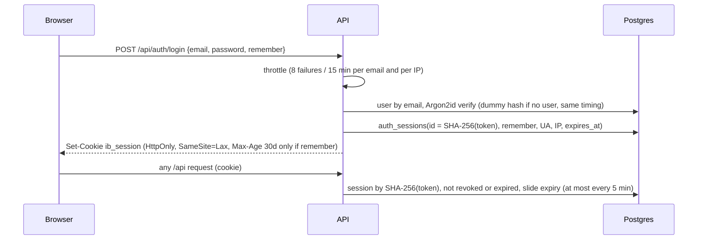

* Email and password; Argon2id hashes (rehashed on login when parameters change). 8–128 characters, not the email.
* "Remember this device": persistent 30-day cookie (sliding). Otherwise a browser-session cookie with a 12-hour
  sliding server lifetime. Devices are listed and revocable on the profile; changing the password signs out every
  other device.
* The database stores only token hashes, so a leaked table can't be replayed.
* First account = admin (and owner of interviews created before accounts existed). Admins approve interviewer lessons
  and manage the shared voice catalogue; lessons never auto-activate.
* CopilotKit runs reach the agents server-to-server without the browser's cookie, so the browser passes a 12-hour
  HMAC-signed agent token (`/api/auth/agent-token`) in the run's properties; the agents check it and the owner.

### Cookies and analytics

| Cookie | Set by | Purpose | Lifetime |
|---|---|---|---|
| `ib_session` | API, HttpOnly | Sign-in | browser session, or 30 days with "remember" |
| `ib_consent` | Banner (JS) | `all` or `essential` | 1 year |
| `ib_aid` | API, HttpOnly, only after `ib_consent=all` | Anonymous analytics device id | 1 year |

Events (`page_view` with interview ids stripped, `signup`, `login`, `interview_created`, `interview_joined`, ...)
go to `analytics_events` in Postgres; nothing goes to third parties. `GET /api/analytics/summary` returns counts and
daily active devices.

### Code sandbox trust boundary

Everything inside the sandbox process is attacker-controlled, so it never sees expected answers and never decides
pass/fail.

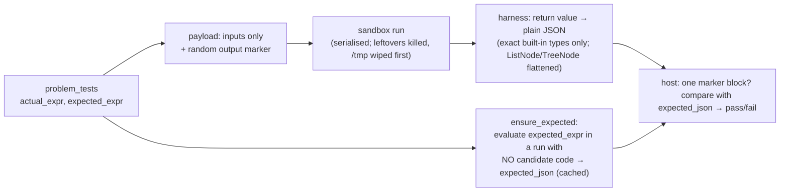

Attacks that worked before this design and are now regression tests (`tests/test_sandbox_security.py`): an object
whose `__eq__` always returns True (was 80/80 passing), reading expected answers out of interpreter memory (was 59/72
hidden passing), and leaving files or background processes for the next run (both survived). PID 1 in the sandbox is
a small reaper, so killed processes can't accumulate against the pids limit.

### HTTP hardening

API responses carry `X-Content-Type-Options: nosniff`, `X-Frame-Options: DENY`, a `default-src 'none'` CSP and
`Referrer-Policy`; auth responses are `no-store`. The web server sends frame denial and a `Permissions-Policy`
limiting camera and microphone to the app's origin. State-changing requests and WebSocket handshakes from another
origin are rejected. Avatars are accepted only if their bytes are PNG, JPEG or WebP. Interview creation (LLM cost),
sign-ups and analytics writes are rate-limited; one sandbox run per interview at a time.

### Tests

Integration tests run against a separate `interviewbud_test` database (a guard refuses any other), with the real
sandbox and the real problem bank: sign-up/login/logout cookies, throttling, cross-site blocks, owner isolation over
REST and WebSocket, password change revoking other devices, admin-only global changes, avatar byte checks, security
headers, the injection wrapper, the zip-bomb guard and the sandbox attacks above.

---

## 21. Preparation journey: from a job link to practice

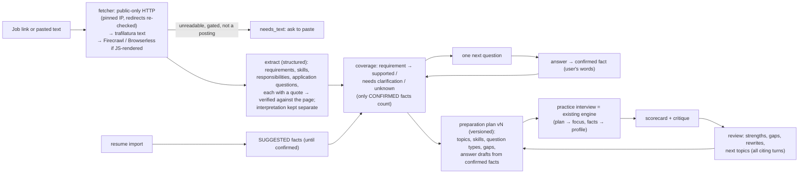

* **Tables:**
  * `opportunities`: source, fetch method and status, page text, extraction, interpretation.
  * `profile_facts` with `profile_fact_revisions`: shared per user.
  * `prep_sessions`: status, pending action, coverage, feedback.
  * `prep_questions` and `prep_plans` (versioned).
  * `interviews.prep_id` and `interviews.plan_version` link each practice to its plan.
* **Statuses:** `intake → needs_text | context → planning → plan_ready → practicing → reviewed`. `pending_action` is
  what the page shows as "Next".
* **Grounding:** an extracted item counts as "from the posting" only if its quote is found in the page text (case,
  whitespace, markdown and quote styles normalised). Answers are stored verbatim as confirmed facts, and resume
  facts arrive as suggestions. Drafts use confirmed facts only and mark what's missing in [brackets]. Web pages,
  answers and resumes reach the model as untrusted blocks.
* **Never automatic:** application answers are only drafted, edited and approved. Nothing is filled in or submitted.
* **Speed:** journey steps run with `PREP_REASONING_EFFORT=low`. Measured: intake 48 s, plan 39 s, practice setup
  44 s, feedback about 2 min after scoring.
* **Durability:** every step's output is in Postgres. On startup `resume_interrupted_work()` restarts intake, planning
  and scoring that a restart cut short.
* The test record is in [`prep-journey-test-log.md`](prep-journey-test-log.md).

---

## 22. Known limits

* **The live LLM is slow** (section 18), and the 50k tokens/min limit causes 429 back-off under normal interview
  pace.
* **Echo on speakers.** The browser's echo cancellation removes most of the interviewer's voice, but one phantom
  candidate turn ("Interesting.") appeared in the live test. Headphones are recommended in the lobby. A planned
  fix is to discard short low-confidence utterances heard while the interviewer is speaking.
* **Whisper `small.en` mishears some technical words** ("hints" → "hands", "pseudocode" → "cudacode"). A larger
  model costs more latency.
* **Hidden-test grading is Python only**, because the dataset's tests are Python.
* **Google Meet joining is not built.** The session runtime is transport-agnostic, so a meeting-bot transport
  could be added.
* **Pocket TTS voice cloning** needs Kyutai's gated weights (accept the terms at huggingface.co/kyutai/pocket-tts,
  then `uvx hf auth login`).
* **Sessions are in-process.** `RUNTIMES` and the throttles live in one API process; scaling out would need sticky
  routing and a shared store (Redis) for throttles.
* **Set `COOKIE_SECURE=true` behind HTTPS** so the session cookie is never sent over plain HTTP.
* **The API controls Docker** to run the sandbox, which is root-equivalent on the host: run the API on a dedicated
  machine or move the sandbox behind a separate runner service (or gVisor/Firecracker) for production.
* **No email verification or password reset yet** (both need an email provider).
