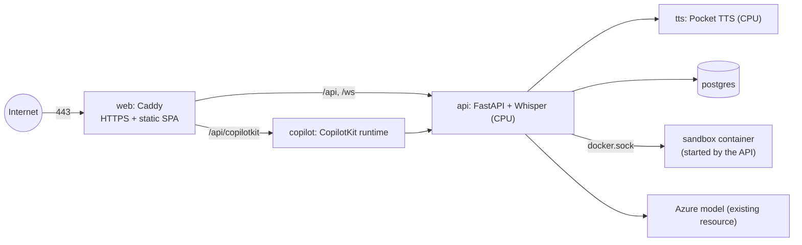

# Deploying InterviewBud

Production runs on one Azure VM with Docker Compose.

| | |
|---|---|
| VM | `interviewbud-prod`, `Standard_D8s_v5` (8 vCPU, 32 GB), Ubuntu 24.04, resource group `interviewbud-prod-rg`, Central India |
| Address | `https://interview.getmetacognition.com` (DNS at NS1: `A interview → 104.211.94.228`) and `https://interviewbud-prod.centralindia.cloudapp.azure.com` |
| Firewall | 80/443 open; SSH only from the admin IP set at deploy time (`allow-ssh-admin` rule) |
| SSH | `ssh ib-prod` (key `~/.ssh/interviewbud_prod`) |

## What runs



* `web` gets and renews Let's Encrypt certificates for every hostname in `DOMAINS` automatically.
* `api` mounts the host's Docker socket to run candidate code in the hardened sandbox container. That is
  root-equivalent on the VM, which is why the VM runs nothing else.
* Data lives in Docker volumes:
  * `pgdata`: the database.
  * `api_data`: the problem bank, Whisper model and signing key.
  * `tts_data`: TTS weights and voices.
  * `caddy_data`: certificates.

## Deploy or update

```bash
deploy/deploy.sh            # from the repo root on your machine
```

The script does the following:

1. On the first run, creates `deploy/.env.prod` (gitignored, mode 600). Your Azure settings are copied from
   `.env`, and new random secrets are generated for the database, the TTS key and session signing.
2. Copies the code to the VM with rsync, leaving out local data, virtualenvs and model weights.
3. Builds the sandbox image and the four service images on the VM, then restarts what changed.

The first start downloads the problem bank (about 2,900 problems) and the Whisper and TTS models, which takes a
few minutes. On startup the API also resumes any scoring or planning that was interrupted.

## Day to day

```bash
ssh ib-prod 'cd interviewbud && docker compose -f deploy/compose.prod.yml --env-file deploy/.env.prod ps'
ssh ib-prod 'cd interviewbud && docker compose -f deploy/compose.prod.yml --env-file deploy/.env.prod logs -f api'
# database backup to the VM's home directory
ssh ib-prod 'docker exec interviewbud-postgres-1 pg_dump -U interviewbud interviewbud | gzip > ~/backup-$(date +%F).sql.gz'
# stop billing when idle (deallocates the VM; the static IP and data are kept)
az vm deallocate -g interviewbud-prod-rg -n interviewbud-prod
az vm start -g interviewbud-prod-rg -n interviewbud-prod
```

## First sign-up

The first account created on a fresh install becomes the **admin** and can approve interviewer lessons and manage
the shared voices. Sign up yourself before sharing the link.

## Changing secrets

Edit `deploy/.env.prod` and run `deploy/deploy.sh` again. If the SSH rule needs a new admin IP:

```bash
az network nsg rule update -g interviewbud-prod-rg --nsg-name interviewbud-prodNSG -n allow-ssh-admin \
  --source-address-prefixes <your-ip>/32
```
